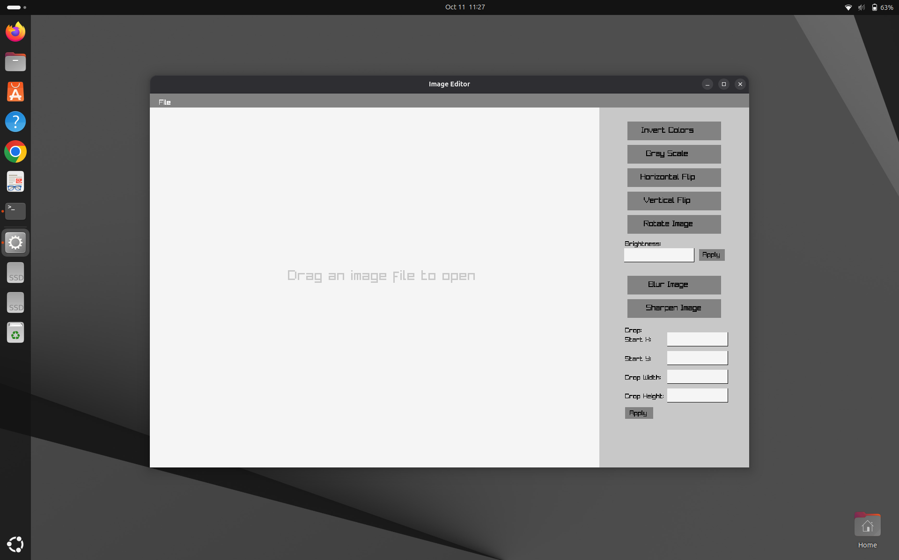
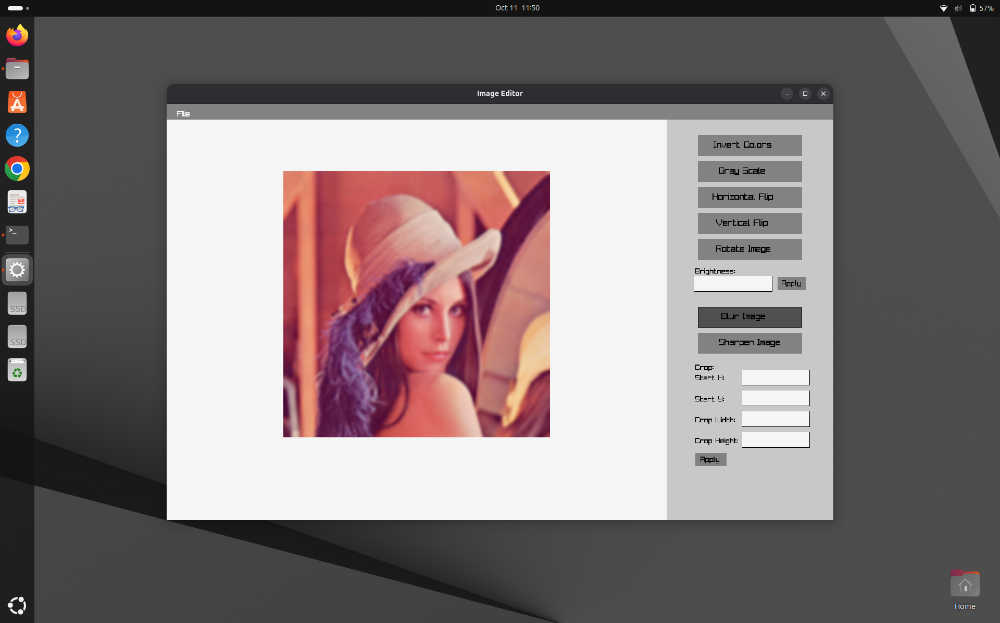
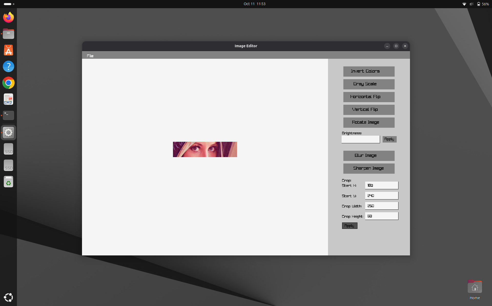
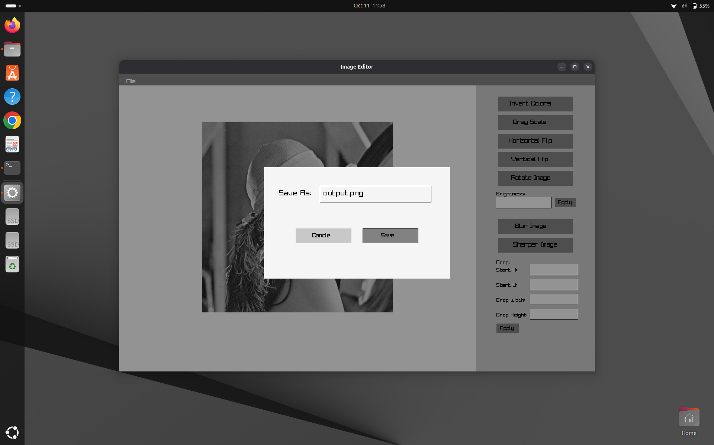

# 🎨 Raylib C Image Editor

A lightweight, desktop-based image editing application written entirely in C using the **Raylib** library. This project features a custom graphical user interface (GUI) and performs image processing through direct manual pixel manipulation, avoiding reliance on heavy external image processing libraries[cite: 2].

 
*Screenshot of the main editor interface*

---

## ✨ Features

The editor supports a variety of image processing tools and transformations, all handled via custom algorithms built from scratch[cite: 2]:

*   🌗 **Color Adjustments:** Apply color inversion or convert images to grayscale[cite: 2].
*   ☀️ **Brightness Control:** Adjust pixel brightness based on custom numerical offset inputs[cite: 2].
*   🔄 **Transformations:** Rotate the image 90 degrees or flip it horizontally and vertically[cite: 2].
*   ✂️ **Custom Cropping:** Crop the image precisely by defining Start X, Start Y, Width, and Height parameters[cite: 2].
*   💧 **Filters:** Apply custom Blur or Sharpen algorithms to your images[cite: 2].
*   💾 **File Export:** Save your edited output to disk via a custom save interface[cite: 2, 3].

### Feature Previews
| Blur | Crop | Save Interface |
|:---:|:---:|:---:|
|  |  |  |

*(Visual assets sourced from the `assets/` directory)*

---

## 📁 Supported File Formats

This project relies on Raylib's default internal `stb_image` loader. 
*   ✅ **PNG** (`.png`) - Recommended for full transparency support.
*   ✅ **BMP** (`.bmp`) - Recommended for uncompressed pixel data.

*Note: Highly compressed modern web formats disguised as standard extensions (e.g., WEBP masquerading as a `.jpg`) will fail to load.*

---

## 💻 System Requirements

*   **Operating System:** Linux (Tested on Ubuntu/Debian-based distributions).
*   **Compiler:** GCC (or any standard C11 compiler).
*   **Build System:** GNU Make.
*   **Version Control:** Git.
*   **Dependencies:** Standard Linux X11/OpenGL graphics headers (typically pre-installed, or available via `sudo apt install libgl1-mesa-dev libxi-dev libxcursor-dev libxrandr-dev libxinerama-dev libx11-dev`).

---

## 🚀 How to Clone and Run

This project uses a Git submodule to handle the Raylib library locally. **You do not need to install Raylib globally on your system.**

**1. Clone the repository (Important: use the recursive flag)**
```bash
git clone --recursive [https://github.com/AAMahadi/image_editor.git](https://github.com/AAMahadi/image_editor.git)
cd image_editor